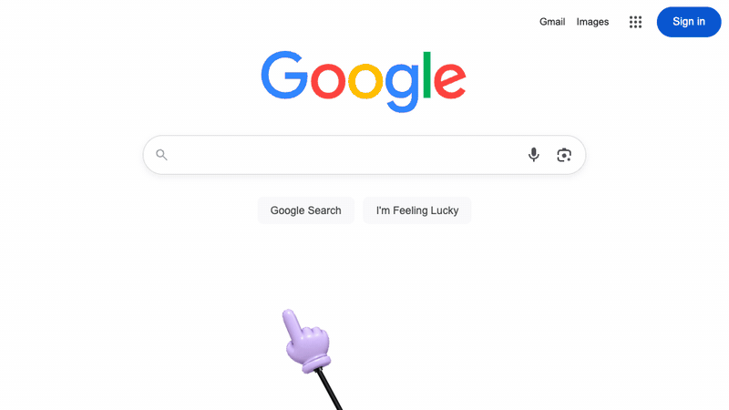
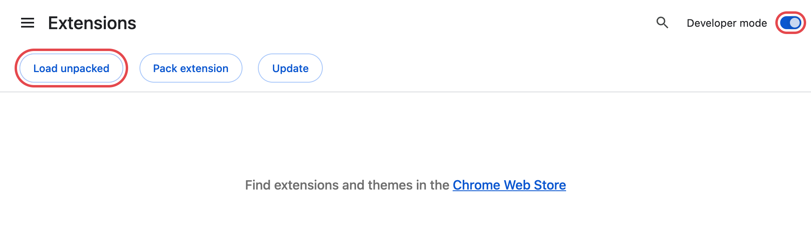
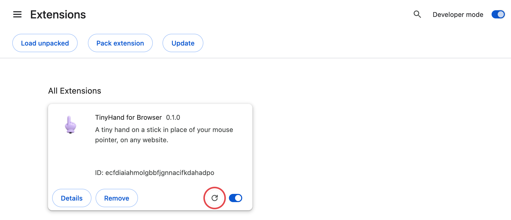
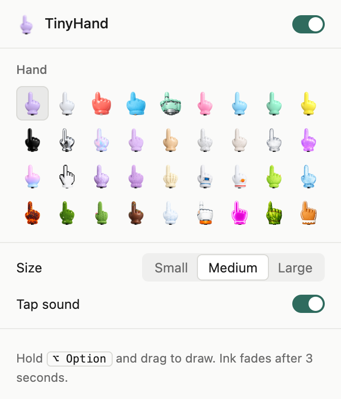

# TinyHand for Browser

A tiny hand on a stick in place of your mouse pointer, on any website. Hold Alt and drag to draw
on the page.

This is a browser port of [TinyHand](https://github.com/nilbuild/tinyhand), the macOS app by
[Kamran Ahmed](https://github.com/kamranahmedse). It works on Windows, macOS and Linux.

  

## Install

Works in Chrome, Edge, Brave and Arc.

**1. [Download TinyHand-Browser.zip](https://github.com/IGWPark/tinyhand-browser/releases/latest/download/TinyHand-Browser.zip)** and unzip it.

**2.** Open `chrome://extensions` (`edge://extensions` in Edge). Turn on **Developer mode**, click
**Load unpacked** and choose the unzipped `TinyHand-Browser` folder. Chrome asks for Developer mode for
extensions that are not from the Chrome Web Store.

**3. Done.** TinyHand for Browser appears in the list. Refresh any tabs that were already open.

**To update**, download the zip again, replace the old folder with the new one and click the
reload button on TinyHand for Browser.

## Use

The hand follows your mouse and clicks work as usual.

- **Draw:** hold `Alt` (`⌥ Option` on macOS) and drag. Ink fades after 3 seconds.
- **Settings:** click the TinyHand icon in the toolbar to pick a hand, change its size, mute the
  tap sound or turn the hand off.

## Acknowledgements

[TinyHand](https://github.com/nilbuild/tinyhand) by [Kamran Ahmed](https://github.com/kamranahmedse),
for the idea, the hand artwork, the tap sound and the hand-on-a-stick motion this port follows.

## License

MIT. See [LICENSE](LICENSE). The hand artwork and tap sound come from TinyHand and are MIT
licensed, copyright Kamran Ahmed. See [licenses/tinyhand.txt](licenses/tinyhand.txt).
