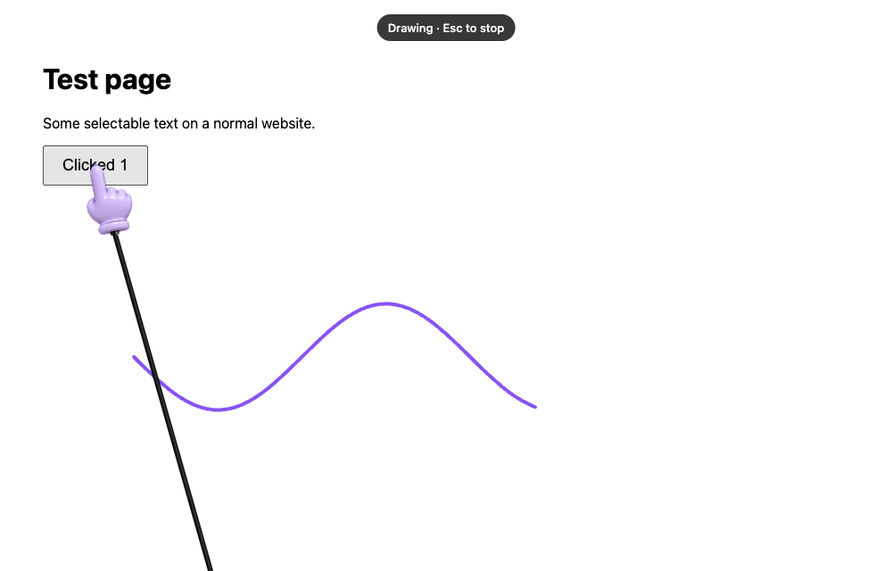

# TinyHand for the browser

A tiny hand on a stick in place of your mouse pointer, on any website.

This is a browser port of [TinyHand](https://github.com/nilbuild/tinyhand), the macOS app by
[Kamran Ahmed](https://github.com/kamranahmedse). It brings the same hands to Chrome, Edge, Brave,
Arc and Firefox on Windows, macOS and Linux. Useful for screen shares, recordings and demos, when
people need to see what you are pointing at.

<p align="center">
  
</p>

## Install

Not on the extension stores yet. Build it from source:

```sh
git clone https://github.com/IGWPark/tinyhand-extension.git
cd tinyhand-extension
pnpm install
pnpm build            # Chrome, Edge, Brave, Arc
pnpm build:firefox    # Firefox
```

**Chrome, Edge, Brave, Arc:** open `chrome://extensions` (`edge://extensions` in Edge), turn on
**Developer mode**, click **Load unpacked** and pick `.output/chrome-mv3`.

**Firefox:** open `about:debugging#/runtime/this-firefox`, click **Load Temporary Add-on** and
pick any file in `.output/firefox-mv2`.

Reload tabs that were open before you installed.

## Use

The hand follows your mouse and clicks work as usual. Click the toolbar icon to pick one of 36
hands, change its size or mute the tap sound.

| Action                         | Windows and Linux | macOS |
| ------------------------------ | ----------------- | ----- |
| Show or hide the hand          | `Alt+Shift+H`     | `⌥⇧H` |
| Start or stop drawing          | `Alt+Shift+D`     | `⌥⇧D` |
| Stop drawing and clear the ink | `Esc`             | `Esc` |

While drawing, drag anywhere to draw. Ink fades after 3 seconds, and the page ignores your clicks
until you stop. The popup shows your current shortcuts. Change them at
`chrome://extensions/shortcuts`, or in Firefox under **Manage Extension Shortcuts** in
`about:addons`.

## Limitations

- Browsers do not run extensions on their own pages (settings, new tab, web stores), so the
  normal pointer shows there.
- In fullscreen (video players, presentations) the normal pointer shows.
- Over embedded frames, such as some video embeds and payment forms, the normal pointer shows and
  the hand waits at the frame's edge.
- Touch input has no pointer, so the hand only follows a mouse, trackpad or pen.

## Development

```sh
pnpm dev              # opens Chrome with the extension and reloads on save
pnpm dev:firefox
pnpm check            # type check
pnpm zip              # store-ready zip in .output
```

Built with [WXT](https://wxt.dev). The content script draws the hand on a canvas in a shadow root
over the page, and hides the system pointer with one stylesheet rule. Hand geometry lives in
[`src/utils/hands.ts`](src/utils/hands.ts).

## Acknowledgements

- [TinyHand](https://github.com/nilbuild/tinyhand) by [Kamran Ahmed](https://github.com/kamranahmedse),
  for the idea, the hand artwork, the tap sound and the hand-on-a-stick motion this port follows.

## License

MIT. See [LICENSE](LICENSE). The hand artwork and tap sound come from TinyHand and are MIT
licensed, copyright Kamran Ahmed. See [licenses/tinyhand.txt](licenses/tinyhand.txt).
